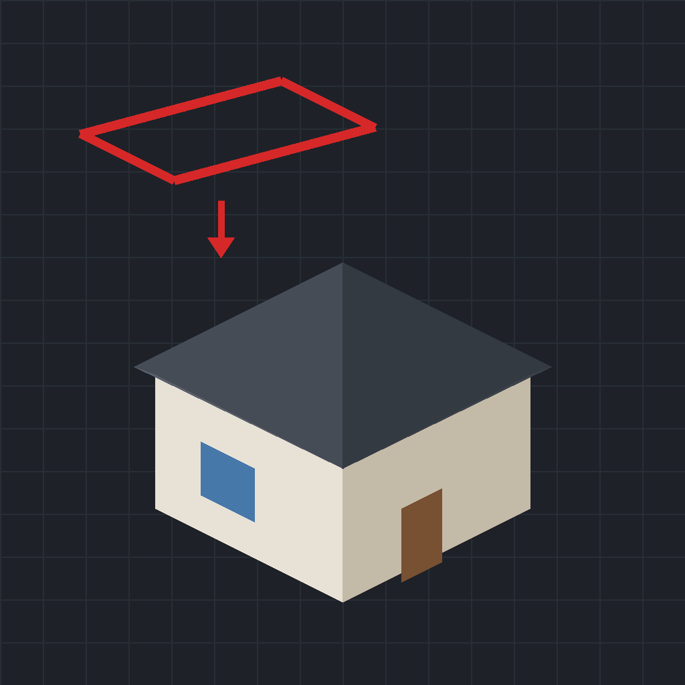

# floorplan-to-3d-house

A **Claude plugin** (Cowork and Claude Code) that turns a house **site plan or floor plan** (vector PDF or DXF) into:

- a clean **DXF**;
- a **simplified 2D plan for approval**;
- an **interactive 3D model** with Orbit / Walk / Drone navigation and a sun study;
- **GLB / 3D-DXF exports** and reference renders;
- an optional **Blender drone or walkthrough video**.

> Indicative proposals only, not for construction or permit applications.



## Install

**Claude Code**
```
/plugin install floorplan-to-3d-house --marketplace paulodinis/floorplan-to-3d-house
```
On older versions:
```
/plugin marketplace add paulodinis/floorplan-to-3d-house
/plugin install floorplan-to-3d-house@paulodinis
```

**Claude desktop (Cowork):** download `floorplan-to-3d-house.plugin` from the [latest release](../../releases/latest), open it in a chat and press install.

**Claude.ai (web), skill only:** download `floorplan-to-3d-house-skill.zip` from the release and upload it under Settings → Capabilities → Skills.

## Skills
| Command | What it does |
|---|---|
| `/floorplan-to-3d-house` | Full workflow: intake (optional style photos and location) → DXF → 2D plan **approval gate** → 3D page → exports → optional video |
| `/validate-plan` | Design QA (setbacks, stairs, doors, room sizes, area cap) and a regenerated 2D approval plan |
| `/drone-video` | Blender video (15 / 30 / 60 s, walkthrough with doors opening) for an approved project |

Full documentation: [plugins/floorplan-to-3d-house/README.md](plugins/floorplan-to-3d-house/README.md).

## Repository layout
```
.claude-plugin/marketplace.json     marketplace catalogue (this repo is a one-plugin marketplace)
plugins/floorplan-to-3d-house/      the plugin: manifest, 3 skills, scripts, CC0 textures, example, docs
```

## License
MIT. Bundled textures are CC0 (Poly Haven); see [THIRD_PARTY_NOTICES](plugins/floorplan-to-3d-house/THIRD_PARTY_NOTICES.md).
